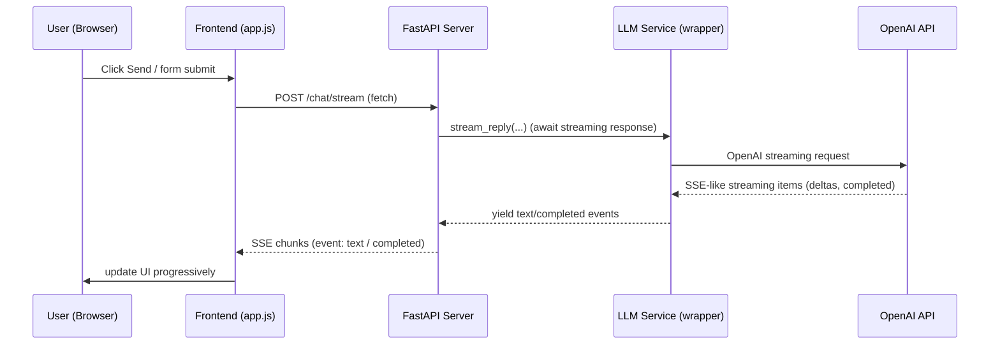

# AIChat

A lightweight streaming AI assistant built with FastAPI and OpenAI's Responses API. This repo includes a simple JavaScript frontend that streams responses (SSE) from the backend and supports tool-enabled assistant and text analysis endpoints.

---

**Contents**
- **Setup** — local environment and running the app
- **Endpoints** — documented API surface
- **Request flow** — sequence diagram of a chat request
- **Architecture** — high-level component diagram
- **Tech stack** — libraries and tools used
- **Features** — what the app provides
- **Docker** — how to run in a container
- **Testing** — how to run tests
- **What I learned** — notes from development
- **Limitations** — known gaps
- **Future improvements** — roadmap ideas

---

**Setup (local)**

- Create and activate a Python virtual environment (Windows example):

```powershell
python -m venv .venv
.\.venv\Scripts\Activate.ps1
pip install -r requirements.txt
```

- Create an `.env` or set environment variables for the OpenAI API key and model. Example `.env` entries used by `app/core/config.py`:

```
OPENAI_API_KEY=sk-...
OPENAI_MODEL=gpt-4o-mini
```

- Run the development server:

```powershell
uvicorn app.main:app --reload
```

- Open http://127.0.0.1:8000/ in your browser.

---

**API Endpoints**

- `GET /` — Serves the single-page frontend (app/static/index.html).
- `GET /health` — Returns a simple JSON health check: `{ "status": "healthy" }`.

- `POST /chat` — Non-streaming chat request. Request body: `ChatRequest` (`message: str`, `conversation_id: Optional[str]`). Response: `ChatResponse` with `reply`, `model`, `conversation_id`.

- `POST /chat/stream` — Streaming chat endpoint (SSE). Accepts `ChatRequest` in the POST body. SSE events emitted:
	- `conversation` — initial event containing `conversation_id` and `model`.
	- `text` — incremental text deltas: `{ "delta": "..." }`.
	- `completed` — finalization event with `response_id`.
	- `error` — error event with `{ "message": "..." }`.

- `DELETE /chat/{conversation_id}` — Delete conversation metadata from the in-memory conversation store.

- `POST /analysis` — Text analysis endpoint. Request body: `{ "text": "..." }`. Returns structured `AnalysisResponse` (analysis result and model).

- `POST /assistant` — Tool-enabled assistant. Request body: `{ "message": "..." }`. Returns assistant reply plus `tools_used` metadata.

Refer to the `app/api` package for request/response model definitions.

---

**Request Flow (chat streaming)**



---

**Architecture**

```mermaid
graph TD
	Browser[Browser UI] -->|fetch /chat/stream| FastAPI[FastAPI app (uvicorn)]
	FastAPI -->|calls| LLMService[LLMService wrapper]
	LLMService -->|HTTP| OpenAI[OpenAI Responses API]
	FastAPI -->|serves| Static[Static files (JS/CSS/HTML)]
	ToolSvc[Tool Assistant Service] -->|optional| FastAPI
```

---

**Tech stack**

- Python 3.10+ (typings used)
- FastAPI (web framework)
- Uvicorn (ASGI server)
- OpenAI Python client (Responses API, streaming)
- Plain JavaScript frontend (static files in `app/static`)
- pytest (tests in `tests/`)

---

**Features**

- Streaming chat via SSE (incremental response rendering)
- Conversation chaining using `previous_response_id`
- Tool-enabled assistant (external tool calls)
- Text analysis endpoint for structured outputs
- Minimal single-file frontend to demonstrate streaming behavior

---

**Docker (recommended)**

Example `Dockerfile` (recommended for production-like runs):

```dockerfile
FROM python:3.11-slim
WORKDIR /app
COPY . /app
RUN python -m pip install --upgrade pip && \
		pip install -r requirements.txt
ENV PORT=8000
EXPOSE 8000
CMD ["uvicorn","app.main:app","--host","0.0.0.0","--port","8000"]
```

Build and run:

```bash
docker build -t aichat:latest .
docker run -e OPENAI_API_KEY=sk-... -p 8000:8000 aichat:latest
```

Notes: set `OPENAI_API_KEY` (and any other env vars) when running the container.

---

**Testing**

- Run the test suite with `pytest` from the project root:

```bash
pytest -q
```

- Individual tests are under the `tests/` folder. Use the `-k` option to filter by test name.

---

**What I learned**

- Streaming responses require both server-side streaming and client-side incremental rendering — small HTML/JS mismatches (IDs or non-async handlers) can silently break the UI.
- Surface API errors clearly to users (e.g., billing or quota errors from OpenAI) instead of letting them surface as generic exceptions.

---

**Limitations**

- In-memory `conversation_store` — not persistent across restarts.
- No authentication or rate-limiting; sensitive to exposing the API key if deployed insecurely.
- Basic frontend: not production hardened (no input sanitization, no reconnection logic for SSE).

---

**Future improvements**

- Persist conversations to a database (Postgres/SQLite) for durability.
- Add authentication + per-user quota and rate limiting.
- Improve frontend UX: streaming spinner, partial token highlighting, reconnection and error UI.
- Add observability: metrics, tracing, and structured logs for production.
- Provide CI that runs tests and lints, and a release pipeline with container image publishing.

---

If you'd like, I can also add a `Dockerfile` and a simple `Makefile`, or create a `docs/` folder with example API requests (Postman/HTTPie snippets). Pull requests welcome.
